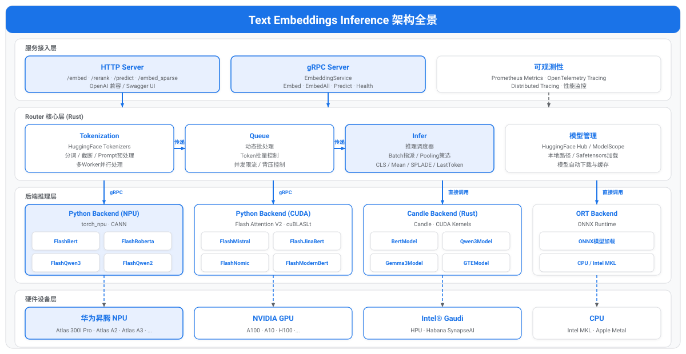

<h1 align="center">Text Embeddings Inference</h1>

<h2>昇腾 NPU 加速版本</h2>

 
 

## ✨ 最新消息

🔹 **[2026.5.26]**：🚀 适配NPU支持flash attention, Qwen3 embedding系列模型性能大幅提升 

## ℹ️ 简介
文本嵌入推理（TEI）是一个用于部署和服务开源文本嵌入和序列分类模型的工具包, TEI 能够为最流行的模型提供高性能推理。主要适配Python Backend模块支持在华为NPU卡上对Embedding、 Reranker、Sequence Classification等模型服务高性能推理。

## 支持的模型清单

### 文本嵌入模型
| 模型名称                                                                                                    | 模型类型        | 模型必配参数                                         |
|---------------------------------------------------------------------------------------------------------|-------------|------------------------------------------------|
| [BAAI/bge-large-zh-v1.5](https://www.modelscope.cn/models/BAAI/bge-large-zh-v1.5)                       | BERT        | -                                              |
| [BAAI/bge-m3](https://www.modelscope.cn/models/BAAI/bge-m3)                                             | XLM-RoBERTa | -                                              |
| [aspire/acge_text_embedding](https://www.modelscope.cn/models/yangjhchs/acge_text_embedding)            | BERT        | -                                              |
| [jinaai/jina-embeddings-v2-base-zh](https://www.modelscope.cn/models/jinaai/jina-embeddings-v2-base-zh) | BERT        | -e TRUST_REMOTE_CODE=1                         |
| [Alibaba-NLP/gte-Qwen2-1.5B-instruct](https://www.modelscope.cn/models/iic/gte-Qwen2-1.5B-instruct)     | Qwen2       | -e TRUST_REMOTE_CODE=1  -e IS_CAUSAL=false |
| [Alibaba-NLP/gte-Qwen2-7B-instruct](https://www.modelscope.cn/models/iic/gte-Qwen2-7B-instruct)         | Qwen2       | -e TRUST_REMOTE_CODE=1  -e IS_CAUSAL=false |
| [Qwen/Qwen3-Embedding-0.6B](https://www.modelscope.cn/models/Qwen/Qwen3-Embedding-0.6B)                 | Qwen3       | -                                              |
| [Qwen/Qwen3-Embedding-4B](https://www.modelscope.cn/models/Qwen/Qwen3-Embedding-4B)                     | Qwen3       | -                                              |
| [Qwen/Qwen3-Embedding-8B](https://www.modelscope.cn/models/Qwen/Qwen3-Embedding-8B)                     | Qwen3       | -                                              |
| [microsoft/unixcoder-base](https://www.modelscope.cn/models/microsoft/unixcoder-base)                   | RoBERTa     | -                                              |

### 序列分类和排序模型
| 模型名称                                                                                        | 模型类型        | 模型必配参数                                                                                                                                                                       |
|---------------------------------------------------------------------------------------------|-------------|------------------------------------------------------------------------------------------------------------------------------------------------------------------------------|
| [BAAI/bge-reranker-large](https://www.modelscope.cn/models/BAAI/bge-reranker-large)         | XLM-RoBERTa | -                                                                                                                                                                            |
| [BAAI/bge-reranker-v2-m3](https://www.modelscope.cn/models/BAAI/bge-reranker-v2-m3)         | XLM-RoBERTa | -                                                                                                                                                                            |
| [Qwen/Qwen3-Reranker-0.6B](https://www.modelscope.cn/models/Qwen/Qwen3-Reranker-0.6B)       | Qwen3       | -e IS_RERANK=1   -e DEFAULT_PROMPT="\<Instruct\>: Given a web search query, retrieve relevant passages that answer the query\\n\<Query\>: \<s1\>\\n\<Document\>: \<s2\>" |
| [Qwen/Qwen3-Reranker-4B](https://www.modelscope.cn/models/Qwen/Qwen3-Reranker-4B)           | Qwen3       | -e IS_RERANK=1   -e DEFAULT_PROMPT="\<Instruct\>: Given a web search query, retrieve relevant passages that answer the query\\n\<Query\>: \<s1\>\\n\<Document\>: \<s2\>" |
| [Qwen/Qwen3-Reranker-8B](https://www.modelscope.cn/models/Qwen/Qwen3-Reranker-8B)           | Qwen3       | -e IS_RERANK=1   -e DEFAULT_PROMPT="\<Instruct\>: Given a web search query, retrieve relevant passages that answer the query\\n\<Query\>: \<s1\>\\n\<Document\>: \<s2\>" |
| [jason9693/Qwen2.5-1.5B-apeach](https://www.modelscope.cn/models/Howeee/Qwen2.5-1.5B-apeac) | Qwen2       | -                                                                                                                                                                            |

## 🚀 快速入门

TEI 提供了一个简单的样例，帮助用户快速体验部署文本嵌入服务。详情可参考[快速入门](./docs/zh/quick_start.md)。

## 🛠️ 贡献指南

欢迎参与项目贡献，请参考[贡献指南](./docs/zh/CONTRIBUTING.md)。

## ⚖️ 相关说明

🔹 [许可证声明](./LICENSE) 
🔹 [免责声明](./docs/zh/disclaimer.md) 
如果有任何疑问或建议，请提交 [GitCode Issues](https://gitcode.com/Ascend/text-embeddings-inference/issues)，我们会尽快回复。感谢您的支持。

## 🔗 相关链接
- [TEI 官方仓库](https://github.com/huggingface/text-embeddings-inference)
- [MindSDK 社区](https://www.hiascend.com/cn/developer/software/mindsdk)

## 🤝 建议与交流

如您在使用或参与过程中有任何问题与想法，可通过以下渠道与我们沟通、提交反馈或加入社区交流。

| 资源                                                                     | 说明           |
|:-----------------------------------------------------------------------|:-------------|
| [FAQ](docker/FAQ.zh.md)                                                | 常见问题解答与使用答疑  |
| [创建Issue](https://gitcode.com/Ascend/text-embeddings-inference/issues) | 提交 Bug、需求或建议 |
| [会议日历](https://meeting.ascend.osinfra.cn/?sig=sig-MindSeriesSDK)       | 社区定期例会与活动日程  |
