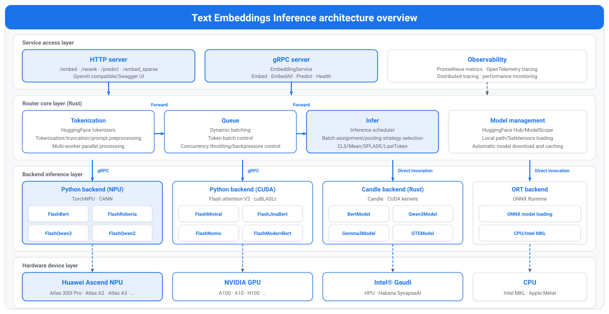

<h1 align="center">Text Embeddings Inference</h1>

<h2>Ascend NPU Accelerated Version</h2>

 
 

## ✨ Latest News

🔹 **[May 26, 2026]**: 🚀 TEI is adapted to the NPU and supports Flash Attention, greatly improving the performance of Qwen3 embedding models. 

## ℹ️ Introduction
Text Embeddings Inference (TEI) is a toolkit for deploying and serving open-source text embedding and sequence classification models. TEI provides high-performance inference for the most popular models. It mainly adapts the Python Backend module to deliver high-performance inference for Embedding, Reranker, Sequence Classification, and other models on Huawei NPU.

## Supported Models

### Text Embedding Models
| Model Name | Model Type | Required Parameters |
|---------------------------------------------------------------------------------------------------------|-------------|------------------------------------------------|
| [BAAI/bge-large-zh-v1.5](https://www.modelscope.cn/models/BAAI/bge-large-zh-v1.5)                       | BERT        | -                                              |
| [BAAI/bge-m3](https://www.modelscope.cn/models/BAAI/bge-m3)                                             | XLM-RoBERTa | -                                              |
| [aspire/acge_text_embedding](https://www.modelscope.cn/models/yangjhchs/acge_text_embedding)            | BERT        | -                                              |
| [jinaai/jina-embeddings-v2-base-zh](https://www.modelscope.cn/models/jinaai/jina-embeddings-v2-base-zh) | BERT        | -e TRUST_REMOTE_CODE=1                         |
| [Alibaba-NLP/gte-Qwen2-1.5B-instruct](https://www.modelscope.cn/models/iic/gte-Qwen2-1.5B-instruct)     | Qwen2       | -e TRUST_REMOTE_CODE=1  -e IS_CAUSAL=false |
| [Alibaba-NLP/gte-Qwen2-7B-instruct](https://www.modelscope.cn/models/iic/gte-Qwen2-7B-instruct)         | Qwen2       | -e TRUST_REMOTE_CODE=1  -e IS_CAUSAL=false |
| [Qwen/Qwen3-Embedding-0.6B](https://www.modelscope.cn/models/Qwen/Qwen3-Embedding-0.6B)                 | Qwen3       | -                                              |
| [Qwen/Qwen3-Embedding-4B](https://www.modelscope.cn/models/Qwen/Qwen3-Embedding-4B)                     | Qwen3       | -                                              |
| [Qwen/Qwen3-Embedding-8B](https://www.modelscope.cn/models/Qwen/Qwen3-Embedding-8B)                     | Qwen3       | -                                              |
| [microsoft/unixcoder-base](https://www.modelscope.cn/models/microsoft/unixcoder-base)                   | RoBERTa     | -                                              |

### Sequence Classification and Reranker Models
| Model Name | Model Type | Required Parameters |
|---------------------------------------------------------------------------------------------|-------------|------------------------------------------------------------------------------------------------------------------------------------------------------------------------------|
| [BAAI/bge-reranker-large](https://www.modelscope.cn/models/BAAI/bge-reranker-large)         | XLM-RoBERTa | -                                                                                                                                                                            |
| [BAAI/bge-reranker-v2-m3](https://www.modelscope.cn/models/BAAI/bge-reranker-v2-m3)         | XLM-RoBERTa | -                                                                                                                                                                            |
| [Qwen/Qwen3-Reranker-0.6B](https://www.modelscope.cn/models/Qwen/Qwen3-Reranker-0.6B)       | Qwen3       | -e IS_RERANK=1   -e DEFAULT_PROMPT="\<Instruct\>: Given a web search query, retrieve relevant passages that answer the query\\n\<Query\>: \<s1\>\\n\<Document\>: \<s2\>" |
| [Qwen/Qwen3-Reranker-4B](https://www.modelscope.cn/models/Qwen/Qwen3-Reranker-4B)           | Qwen3       | -e IS_RERANK=1   -e DEFAULT_PROMPT="\<Instruct\>: Given a web search query, retrieve relevant passages that answer the query\\n\<Query\>: \<s1\>\\n\<Document\>: \<s2\>" |
| [Qwen/Qwen3-Reranker-8B](https://www.modelscope.cn/models/Qwen/Qwen3-Reranker-8B)           | Qwen3       | -e IS_RERANK=1   -e DEFAULT_PROMPT="\<Instruct\>: Given a web search query, retrieve relevant passages that answer the query\\n\<Query\>: \<s1\>\\n\<Document\>: \<s2\>" |
| [jason9693/Qwen2.5-1.5B-apeach](https://www.modelscope.cn/models/Howeee/Qwen2.5-1.5B-apeac) | Qwen2       | -                                                                                                                                                                            |

## 🚀 Quick Start

TEI provides a simple example to help you quickly experience text embedding service deployment. For details, see [Quick Start](./docs/en/quick_start.md).

## 🛠️ Contribution Guide

You are welcome to contribute to this project. For details, see the [Contribution Guide](./docs/en/CONTRIBUTING.md).

## ⚖️ Related Information

🔹 [License Statement](./LICENSE) 
🔹 [Disclaimer](./docs/en/disclaimer.md) 
🔹 [Third-Party Open-Source Software Notice](./Third_Party_Open_Source_Software_Notice) 
If you have any questions or suggestions, please submit them to [AtomGit Issues](https://atomgit.com/Ascend/text-embeddings-inference/issues), and we will reply as soon as possible. Thank you for your support.

## 🔗 Related Links
- [TEI official repository](https://github.com/huggingface/text-embeddings-inference)
- [MindSDK community](https://www.hiascend.com/cn/developer/software/mindsdk)

## 🤝 Feedback and Discussion

If you have any questions or ideas during use or participation, you can communicate with us, submit feedback, or join community discussions through the following channels.

| Resource | Description |
|:-----------------------------------------------------------------------|:-------------|
| [FAQ](docker/FAQ.zh.md) | Answers to frequently asked questions and usage inquiries. |
| [Create an Issue](https://atomgit.com/Ascend/text-embeddings-inference/issues) | Submit bugs, requirements, or suggestions. |
| [Meeting Calendar](https://meeting.ascend.osinfra.cn/?sig=sig-MindSeriesSDK) | Schedules of regular community meetings and activities. |
